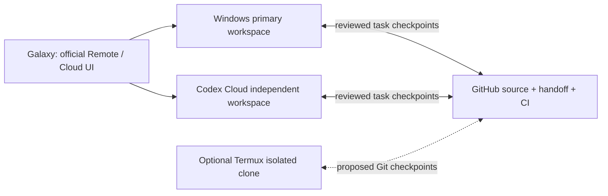

# Unified workspace — Phase 4 extension

Current portability implementation and founder-supplied actual Cloud probes are
recorded in [CLOUD-COMPATIBILITY](CLOUD-COMPATIBILITY.md) and
[PHASE4-VALIDATION](PHASE4-VALIDATION.md). One authoritative repository,
AGENTS/policies, eleven roles, twelve skills, advisory task ownership and reviewed
Git checkpoints remain shared. Windows native execution and capability-aware
Cloud adapters are distinct; no blind synchronization or automatic merge exists.
Actual Phase4 Cloud runtime acceptance is pending. The Phase2 assessment below
is historical; its unverified probes and fixed-hook limitation are extended only
by explicitly identified newer evidence, never retroactively marked successful.

## Historical Phase 2 assessment

Read-only assessment baseline: clean local/live
`165d8e4f899ace8c41323a9c84c02bb732247137` on
`development/omega-commercial-mvp`, exact-SHA CI 44379209466 success.
Assessment date: 2026-11-18 UTC. This is a management architecture/preparation
milestone, not Cloud/Android deployment or activated automatic synchronization.

## Supported surfaces and compatibility

| Surface/asset | Verified or documented capability | Remaining gate |
| --- | --- | --- |
| Windows | Current primary workspace; native Remote and Phase 1 official account limits previously read successfully | Existing signing/device/Notebook gates unchanged |
| Codex Cloud | Official hosted independent workspaces can run while Windows is off; saved-environment inventory read succeeded | Inventory demonstrated no AI Memory repository binding. Actual checkout, runtime/setup, included-use eligibility and Omega parity untested; no environment/task was created |
| GitHub | Authoritative reviewed commits, docs and CI; source is public | Only committed/pushed work is remotely recoverable; no account/secret/session-folder synchronization |
| Galaxy S26 Ultra | Owner-reported native Remote control; official mobile Cloud task entry is documented | No phone/OS/device operation or acceptance performed here |
| Optional Termux/Git | Termux officially provides an Android terminal/package environment including Git | Candidate local clone/docs workspace only. No verified Codex Android runtime, Expo/native toolchain or background reliability; install/device consent required |
| AGENTS.md/policies | Repository instructions are the portable policy source; owner scope remains authoritative | Check actual discovery in each Cloud task; instructions alone are not enforcement |
| Repository skills | Official Cloud docs support repository skills; personal machine skills do not automatically sync | Verify the 12 repository skills are discovered; do not copy personal plugin/cache/config directories |
| Custom agents/config | Local `.codex/agents` and two-specialist cap are preserved | Exact native custom-role dispatch/config parity in Cloud is unverified. Never claim a generic delegate is a registered specialist |
| Existing command hooks | Source inspection found fixed Windows launch paths in `.codex/hooks.json`; hook `.git` reader rejects linked-worktree files | Not portable unchanged. Official Cloud orchestration does not provide local command-hook parity; keep configuration intact and require a separate reviewed portability/policy decision before Cloud writes |
| Host tests | Current CI already exercises Node 22 on Linux; management helpers use Node built-ins | CI is not a successful Codex Cloud bootstrap, Android test or guarantee every tool is preinstalled |

Primary references, checked 2026-11-18:
[Cloud environments](https://learn.chatgpt.com/docs/environments/cloud-environments.md),
[AGENTS discovery](https://learn.chatgpt.com/docs/agent-configuration/agents-md.md),
[subagents](https://learn.chatgpt.com/docs/agent-configuration/subagents.md),
[hook orchestration](https://learn.chatgpt.com/docs/hooks.md),
[Termux](https://termux.dev/en/),
[Termux execution environment](https://github.com/termux/termux-packages/wiki/Termux-execution-environment).
Scope matters: local command hooks and managed enterprise Cloud hooks are different
interfaces. No inference of equivalent protection from a shared filename.

## Target architecture, not a running deployment

Windows Remote requires the host online. The separate Cloud path does not use a
Windows daemon, protected socket, tunnel or public listener. Cloud uses its own
official environment and connected repository access; never copy workstation
credentials, account state, keys or app records. Do not switch this task to a
billable API, buy credits or assume an available environment is cost-approved.

## Conflict-safe synchronization design

Git commits, not live directories, cross environments. Proposed automatic checks
run only at an authorized task's start/checkpoint/reconnection, using existing
official execution surfaces. No scheduler, fetch/push worker or sync executor is
enabled by this phase. The pure `tools/omega-workspace.cjs` planner classifies:

| Observed state | Safe disposition |
| --- | --- |
| Dirty or unknown worktree | Preserve it; no pull, checkout, stash, reset or overwrite |
| Offline | Keep local work and a reviewed local checkpoint when authorized; mark publication pending |
| Missing/stale remote evidence | Unknown; request a fresh exact-branch ref observation, not cached tracking-ref equality |
| Equal full SHAs and clean worktree | In sync at that observation, not a permanent guarantee |
| Local ancestor | Propose fast-forward-only review; recheck all facts immediately before an authorized write |
| Remote ancestor | Propose review/normal checkpoint push; server rejection preserves local work |
| Diverged/unverified ancestry | Isolate/review; never automatic merge/rebase, force push or destructive replacement |

Ancestry comes from actual Git graph checks after an authorized fetch, not a
timestamp or task title. The planner accepts evidence; it cannot authenticate it
or execute a write. Ref/HEAD/cleanliness can change after a plan: an executor must
revalidate immediately before acting and stop on races. Current main/preview stay
protected. Future `omega/<windows|cloud|android>/<task-slug>` branches are proposals;
current CI does not automatically cover that namespace. Extending CI safely is a
separate gate, not a promise of green checks for uncreated branches.

## Task ownership and concurrency

One writer owns each task branch/checkout and approved file set. Assign task slug,
environment, immutable base SHA, branch, owned paths and acceptance criteria before
starting. The pure ownership validator rejects malformed/sensitive paths and flags
case-insensitive file/directory overlap across environments while preserving actual
path case. Invalid declarations count as conflicts. Environment namespaces reduce
accidental branch reuse; they are not exclusive distributed locks.

Keep one Principal coordinator and at most two authorized specialists. Publish only
safe engineering task/path/checkpoint summaries in TASK-QUEUE; actual thread/host
IDs, account telemetry and private operational details stay out of GitHub. Metadata
does not enforce a lock or grant write permission. Do not transfer ownership merely
because a clock/lease expired. If an owner is offline, keep its files reserved and
work on disjoint scope or read-only assessment until an explicit reviewed handoff.
Existing hooks have a worktree limitation, so do not automatically create/use new
linked worktrees before the corresponding safety gate passes.

## Offline recovery and environment-independent handoff

A checkpoint records public-safe task/branch, full source/base SHA, owned paths,
implemented/disabled state, exact test/CI/review evidence, unresolved gates and next
safe step. Use [HANDOFF](HANDOFF.md) and validation records; no machine-specific
paths or account IDs are required. Commit/push only reviewed authorized files.
Uncommitted or unpushed Windows/phone work is unavailable to Cloud; do not pretend
GitHub can recover it while that machine is offline. Preserve it locally and mark
the handoff incomplete. A Cloud task can independently continue from a verified
GitHub checkpoint within disjoint scope after its own governance/setup gates pass.
On reconnect, compare histories before integration; preserve both sides if divergent.

## Quota and laboratory boundaries

Phase 1 official quota reads remain intact. The helper labels the host-account
bucket without inventing Windows/Cloud/Android allocations. Official
[pricing guidance](https://learn.chatgpt.com/docs/pricing.md) says local messages
and Cloud chats can share a plan allowance while consumption varies; it does not
establish equal environment balances. Unknown surface-specific limits remain
unknown. Track source, observation time and supplied window/reset independently;
never multiply one shared remaining allowance across environments.

Apply the founder's [permanent quota policy](USAGE-STATUS.md#permanent-quota-policy)
to both weekly and short-window remaining allowance, using the stricter window:
above 10% normal; <=10% and >5% small controlled work; <=5% and >2% finish existing
work and validate; <=2% and >1% finalize the checkpoint, authorized GitHub sync,
CI evidence and handoff; <=1% mandatory stop. Prepare earlier if needed. Missing
reliable official telemetry permits one bounded milestone then a stop, subject
to any stricter known window; backend denial always stops work. No purchased
credits/top-ups or automatic reset resume. These replace the earlier weekly
reserve guidance and remain cooperative advisory signals, not account-wide
enforcement or new financial/security/release authority. Read-only checks/review
use existing allowance; no Cloud task, paid service, subscription or API billing
was activated.

The existing [Emulator/Maestro plan](ANDROID-EMULATOR-MAESTRO-PLAN.md) now references
disabled synthetic UI inputs. No software, AVD, APK or device operation. Native
Cloud bootstrap/hook parity and any Android setup require a subsequent scoped
decision before implementation; keep product launch work ahead of infrastructure.
